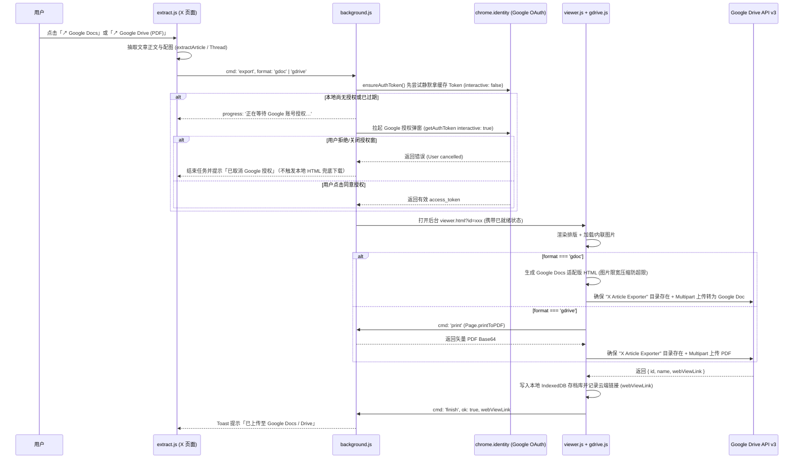

# X Article Exporter 接入 Google Docs 与 Google Drive 云端同步技术方案

- **文档编号**：1
- **创建时间**：2026-11-17 23:36
- **作者**：wangsen
- **适用版本**：基于 `x-article-exporter` v2.7.1 升级至 v2.8.0
- **当前状态**：已完成全部代码研发、增量单测与 `9222` 实机端到端验收（默认窄边框 `36pt` + `720px` 配图宽适配 + Toast/历史锚文本直达 + API 开启引导 + 纯按需授权）

---

## 一、背景与需求目标

### 1.1 业务背景
目前 `x-article-exporter` 已支持将 X (Twitter) 上的长文（Articles）及作者自串（Self-threads）导出为本地文件（`PDF`、`Markdown`、`HTML`），并在扩展本地 IndexedDB（`xae-archive`）中保存自包含快照。

为了解决本地文件跨设备查阅不便、难以直接在线二次编辑与云端集中归档的痛点，在不引入第三方重型平台（如 n8n）的前提下，直接在扩展内原生打通 Google 云端上传能力。

### 1.2 审核定稿核心原则
1. **在现有导出项（PDF / Markdown / HTML）基础上，并列新增两项云端上传能力**：
   - **上传为 Google Docs 在线文档（`gdoc`）**：HTML 自动转换为可在线编辑、带内嵌配图的 Google Doc；
   - **上传为 Google Drive PDF（`gdrive`）**：将矢量排版的 PDF 直接上传归档至 Google Drive。
2. **纯按需授权（Just-In-Time / On-Demand Auth），不做任何前期权限获取**：
   - 安装扩展、打开网页、打开弹窗或使用本地导出（PDF / MD / HTML）时，**零授权打扰，不做任何前置账号绑定或预检请求**；
   - **点击即触发**：仅当用户点击「上传到 Google Docs」或「上传到 Google Drive」时，才检查当前是否有可用令牌；若未授权，当场拉起 Google 账号授权窗，**授权成功后无需二次点击，直接无缝继续当前文章的采集与上传流程**。

---

## 二、UI 入口与简写命名设计

为了与现有的 `PDF`、`Markdown`、`HTML` 保持同级、紧凑且语义一目了然（严格遵守单行不换行规范），设计如下简写方案：

### 2.1 帖子操作栏右键菜单（`extract.js` -> `openFormatMenu`）
右键菜单原本就是「选择导出格式/目标」的紧凑浮层，采用**「目标载体 + 格式说明」**的极简表达：

| 内部 mode | 英文简写 (`en`) | 中文简写 (`zh`) | 行为说明 |
| :--- | :--- | :--- | :--- |
| `pdf` | `PDF` | `PDF` | 现有：本地下载 PDF |
| `md` | `Markdown` | `Markdown` | 现有：本地下载 Markdown |
| `html` | `HTML (self-contained)` | `HTML（自包含）` | 现有：本地下载单文件 HTML |
| `grok` | `Grok Markdown (AI rewrite)` | `Grok Markdown（AI 整理）` | 现有：Grok 改写下载 MD |
| **`gdoc`** | **`↗ Google Docs`** | **`↗ Google Docs（在线文档）`** | **新增：采集并转为 Google Doc 在线文档** |
| **`gdrive`** | **`↗ Google Drive (PDF)`** | **`↗ Google Drive（PDF 云盘）`** | **新增：生成 PDF 并直传 Google Drive** |

> **备选极简英文方案**：若追求极致短促，英文也可写为 **`To Google Docs`** 与 **`To Google Drive (PDF)`**；前缀 `↗` 能直观区分「本地落盘」与「云端上传」。

### 2.2 工具栏弹窗（`popup.html`）
Popup 宽度固定为 `272px`，现有按钮格式为动词开头（`导出为 PDF` / `导出为 Markdown` / `导出为 HTML（自包含）`），新增两行保持对齐与紧凑风格：
- **`转存到 Google Docs`**（或 `上传到 Google Docs`）
- **`上传到 Google Drive (PDF)`**

### 2.3 存档库卡片操作区（`options.html`）
在历史存档卡片的操作按钮行（现有：`打开快照`、`原帖`、`在文件夹中显示`、`删除`）：
- 未上传过云端时：提供 **`↗ Google Docs`** 紧凑按钮（直接读取本地已存档的 `snap.html` 上传，秒级完成，无需回原帖重新滚动抓取）；
- 已上传过云端时：按钮变为 **`打开云端文档`**（点击直接在新标签页打开已记录的 `webViewLink`）。

---

## 三、开源库与技术路线评估（遵循“成熟方案优先、零冗余造轮子”）

| 候选方案 | 维护方 | 适用性评估 | 结论 |
| :--- | :--- | :--- | :--- |
| **`googleapis` / `@googleapis/drive`** | Google 官方 Node SDK | 依赖 Node.js 核心模块，打包后体积超 5MB；当前项目为纯原生无打包 MV3 扩展，不兼容 | ❌ 不采用 |
| **`gapi` (Google API Client JS)** | Google 官方 Web SDK | 需动态加载远程脚本 `https://apis.google.com/js/api.js`，违反 Chrome MV3 CSP 禁止远程代码规定 | ❌ 不采用 |
| **`chrome.identity` + Google Drive REST API v3** | Chrome 原生 API + Google 标准接口 | • **零第三方体积**：直接调用浏览器内置 `chrome.identity` 完成按需 OAuth2 授权；<br>• **云端原生解析**：Google Drive v3 `files.create` 原生支持将 `text/html` 自动解析转换为 Google Docs（`application/vnd.google-apps.document`） | ✅ **选定方案** |

---

## 四、按需权限（On-Demand Auth）与上传全链路设计

### 4.1 权限范围最小化（Non-sensitive Scope）
- OAuth Scope 严格限定为：
  ```text
  https://www.googleapis.com/auth/drive.file
  ```
- **合规性**：属于 Google 非敏感权限（Non-sensitive Scope），仅能访问本扩展自己创建的文件夹与文档，无法读取用户云盘任何其他私人文件，无需 Google CASA 安全审计。
- **可选权限声明（按需申请）**：
  - 在 `manifest.json` 中使用 `permissions: ["identity", ...]`（注：Chrome 官方定义 `identity` 权限本身不产生安装警告）配合按需调用 `chrome.identity.getAuthToken({ interactive: true })`；
  - 绝不在 `background.js` 启动、`onInstalled` 或打开页面时预先调用任何授权接口。

### 4.2 点击后「按需授权 -> 立即上传」时序流程



---

## 五、核心技术细节与防坑设计

### 5.1 授权取消时的兜底隔离（防误下载本地 HTML）
现有 `extract.js` 中，当 `export` 返回 `ok: false` 时，默认会执行 `runLocal(pending.mode, pending.data)` 退回本地下载 HTML。
**针对云端上传模式的专门处理**：
- 若用户点击的是 `gdoc` 或 `gdrive`，且失败原因是**用户主动取消了授权弹窗**（或网络上传错误），应当只展示明确的错误 Toast（如「已取消 Google 授权」或「Google Drive 上传失败：...」），**不要**莫名其妙往用户本地下载一个 `.html` 文件。

### 5.2 HTML 自动转 Google Docs 的图文适配与默认窄边框
1. **默认窄边框格式（Narrow Margins）**：
   - 在 `GDOC_STYLE` 中默认声明 `@page{margin:36pt 36pt 36pt 36pt}`（`0.5in` 窄边距）及 `body{max-width:540pt;padding:36pt 36pt 36pt 36pt;margin:36pt 36pt 36pt 36pt}`，使 Google Docs 自动以窄边框文档排版。
2. **图片适配窄边框版心宽度（`720px`）与体积控制**：
   - Google Docs 导入器不会仅凭 CSS `max-width:100%` 缩小宽图；因此在 `downscaleImagesForGDoc` 中对宽度 `> 1280px` 的大图通过 Canvas 等比缩放到 `1280px`（JPEG `0.85`）以防体积超限，同时按窄边框版心宽度 `GDOC_CONTENT_WIDTH = 720`（`540pt`）精确计算并在 `` 上注入 `width="720" height="..."` 及内联 `style="width:720px;height:...px;max-width:100%"`；对未解码的兜底图也在 `fitGDocImgTag` 中约束为 `width="720"`；
3. **标签与内联样式净化（`buildGDocHtml`）**：
   - 移除 `@media print`、`display: grid` 和外部链接 `::after` 伪元素；
   - 将多图 `figure` 展开为独立段落图片，确保在 Google Docs 中图片按顺序清晰排列；
   - 保留标题（`h1~h4`）、粗体/斜体、行内代码与代码块（`pre/code`）、引用块（`blockquote`）及顶部原文溯源链接。

### 5.3 完成后的锚文本直达与历史记录
1. **页面顶部 Toast 锚文本**：上传成功后，Toast 自动渲染可点击的 `<a target="_blank">` 锚文本（`打开 Google Doc ↗` / `打开云端 PDF ↗`）并保持 15s 可交互展示，一键打开刚上传的在线文档；
2. **存档库上传历史明细（`options.html`）**：通过 `XAEArchive.addFile` 持久化记录 `{ format, filename, fileId, webViewLink, at }`，在每张历史卡片的操作区与底部明细区同时展示云端文件名、上传时间及可点击直达链接；
3. **API 开启与授权引导**：首次按需授权期间推送引导文案；若项目尚未启用 `drive.googleapis.com`（`403`），自动解析控制台链接并通过 Toast / 存档卡片提供 `去开启 API ↗` 引导入口。

### 5.3 云端归档目录幂等管理
1. 默认归档至用户 Google Drive 根目录下的 **`X Article Exporter`** 文件夹；
2. 首次上传时通过 `files.list`（限定 `mimeType='application/vnd.google-apps.folder' and name='X Article Exporter' and trashed=false`）查找，存在则复用并缓存 `gdriveFolderId` 到 `chrome.storage.local`，不存在则自动创建；
3. 若后续上传遇到 `404`（用户手动删了云端文件夹），自动清缓存并重建目录后透明重试。

### 5.4 Token 过期 401 自动刷新
当缓存的 Token 在请求 Google Drive API 时返回 `401 Unauthorized`：
- 自动调用 `chrome.identity.removeCachedAuthToken({ token })` 清除旧 Token；
- 重新调用 `chrome.identity.getAuthToken({ interactive: true })` 获取新 Token 并自动重放上传请求。

---

## 六、涉及修改与新增的文件清单

| 文件路径 | 修改类型 | 具体职责与改动内容 |
| :--- | :--- | :--- |
| `manifest.json` | 修改 | 1. `permissions` 增加 `"identity"`；<br>2. `host_permissions` 增加 `"https://www.googleapis.com/*"`；<br>3. 增加 `oauth2` 配置（`client_id` 与 `scopes: ["https://www.googleapis.com/auth/drive.file"]`） |
| `gdrive.js` | **新增** | 按需 OAuth2 令牌获取与 401 刷新、云端归档目录幂等创建、`buildGDocHtml` 转换器、`uploadAsGoogleDoc` 与 `uploadPdfBlob` Multipart 上传封装 |
| `background.js` | 修改 | 在 `cmd: 'export'` 收到 `format === 'gdoc' \| 'gdrive'` 时，先执行按需授权 `XAEGDrive.ensureToken(true)`，授权成功再拉起 `viewer.html`，并透传 `webViewLink` |
| `viewer.html` / `viewer.js` | 修改 | 引入 `gdrive.js`；在 `viewer.js` 中增加 `gdoc` 与 `gdrive` 上传分支，上传成功后将 `{ format, filename, webViewLink, fileId, at }` 记录到 `XAEArchive.addFile` |
| `extract.js` | 修改 | 1. `I18N`（中/英）新增 `fmtGDoc`、`fmtGDrive` 及上传进度/结果提示；<br>2. 右键菜单新增 `↗ Google Docs` 与 `↗ Google Drive (PDF)`；<br>3. 云端模式失败时不触发本地 HTML 降级下载 |
| `popup.html` / `popup.js` | 修改 | 弹窗导出区新增 `转存到 Google Docs` 与 `上传到 Google Drive (PDF)` 两个按钮 |
| `options.html` / `options.js` | 修改 | 存档库卡片操作区支持将本地已存档快照一键上传至 Google Docs，已上传的展示「打开云端文档」/「打开云端 PDF」直达按钮 |
| `archive.js` | 修改 | `addFile` 支持同时记录本地下载（`downloadId`）与云端同步文件（`fileId` + `webViewLink`），互不覆盖 |
| `test/gdrive.test.js` | **新增** | 覆盖按需静默/交互授权、取消授权不误触发本地下载、401 令牌刷新、归档目录幂等与 404 自愈、HTML 转 Google Docs 净化及 Multipart 上传的增量单测 |

---

## 七、Google Cloud Console 凭据配置说明

1. 在 [Google Cloud Console](https://console.cloud.google.com/) 启用 **Google Drive API**；
2. 配置 **OAuth consent screen**，添加非敏感权限 `.../auth/drive.file`（测试阶段将测试邮箱加入 `Test users`）；
3. 创建 **OAuth client ID**（应用类型选择 **Chrome Extension**，填入扩展固定 ID），将生成的 `Client ID` 写入 `manifest.json` 的 `oauth2.client_id`。

---

## 八、研发落地、单测与实机验收记录

- **单元测试**：`node --test test/gdrive.test.js test/site-lifecycle.test.js`（**14 / 14 通过**）与 `node test-renderRich.js`（**11 / 11 通过**），验证项包括：
  1. `ensureToken` 静默命中缓存令牌时不触发交互弹窗；缓存未命中时按需触发 `interactive: true`（含 `launchWebAuthFlow` 兜底）；
  2. 用户关闭/拒绝 Google 授权窗时准确识别 `AUTH_CANCELLED`，前端仅提示「已取消 Google 账号授权」，不误触发本地 HTML 降级下载；
  3. `fetchWithAuth` 遇到 `401 Unauthorized` 时自动调用 `removeCachedAuthToken` 并重放请求；
  4. `downscaleImagesForGDoc` 与 `buildGDocHtml` 默认注入 `36pt` 窄边框样式、移除 `@media print` 伪元素与 Grid 布局，并将正文配图精确计算并适配为 `720px`（`540pt`）窄边框版心宽度；
  5. `parseDriveError` 在遇到 `403` 未启用 Google Drive API 时精准提取控制台开启引导链接 `guideUrl`；
  6. `uploadAsGoogleDoc` 与 `uploadPdfBlob` 幂等创建 `X Article Exporter` 归档目录（含并发去重锁 `folderInflight`），并在目录被删返回 `404` 时自动清缓存重建重试；
  7. `background.js` 在启动与本地导出（`pdf` / `md` / `html`）时零授权调用，仅在 `gdoc` / `gdrive` 时按需触发授权。
- **9222 Chrome 实机验收**：
  1. 已在 Google Cloud Console（项目 `wadesk-436602`）完成 **GoodExts** 品牌名、图标及单一域名 `goodexts.com` 配置，启用 `Google Drive API`，创建正式 Chrome Web Store OAuth Client ID（`51782706977-0jrjqmeilsv9hoaaudif7i99kdnk195q.apps.googleusercontent.com`，绑定正式商店 ID `akmedeebhjkchcpocceffimhpmfjimhn`）写入 `manifest.json`，并将 Web Auth 重定向 URI 兼容商店 ID 与本地调试 ID。
  2. 实机运行 `window.__XAE_RUN('gdoc')`（`@thedankoe` 含 3 张配图长文）一次跑通：
     - 导出回查 Google Docs HTML 实测：`body` 为 `max-width:540pt;padding:36pt 36pt 36pt 36pt`（窄边框生效），3 张内嵌配图均精确渲染为 `width: 720.00px`；
     - 页面顶部 Toast 正常渲染可点击锚文本 `打开 Google Doc ↗`；
     - 存档库 `options.html` 卡片底部完整记录并展示了云端文档名、上传时间及可点击直达链接。
  3. 实机运行 `window.__XAE_RUN('gdrive')` 生成矢量 PDF 并上传至 Google Drive 成功。
